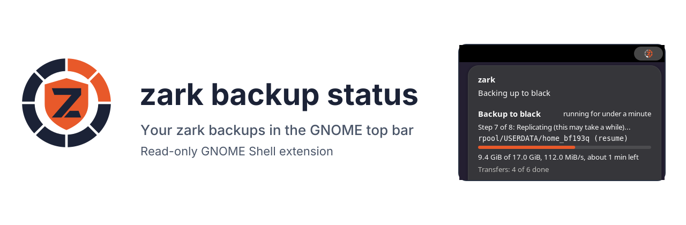
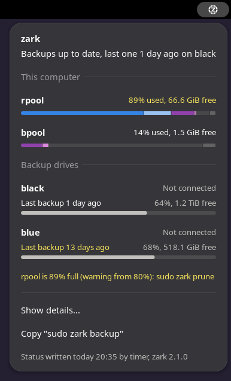
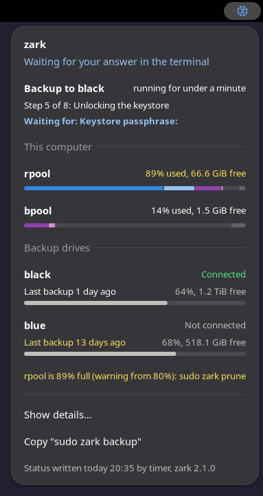
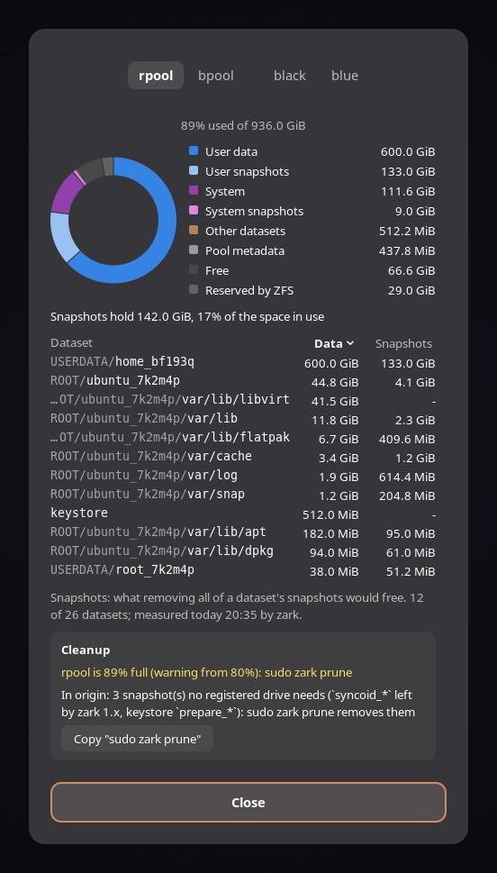
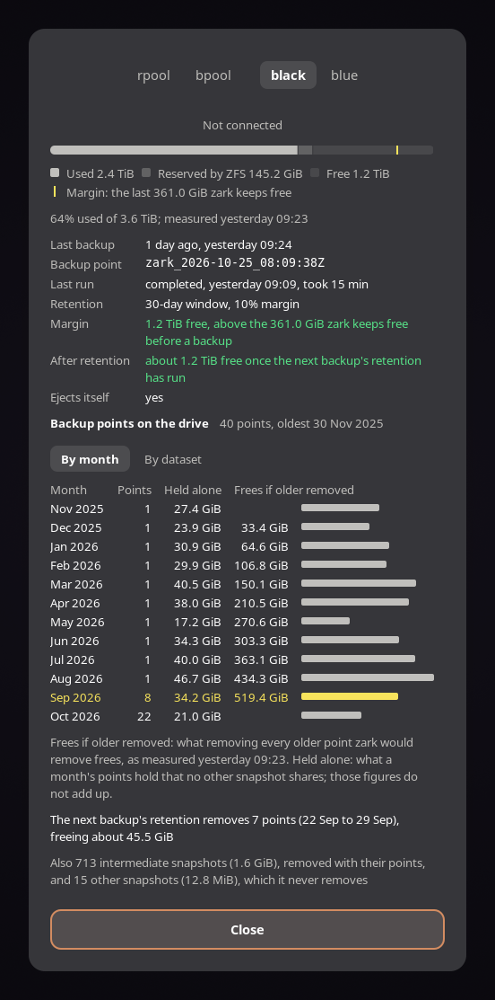
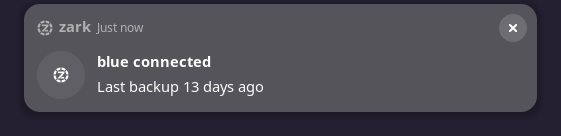
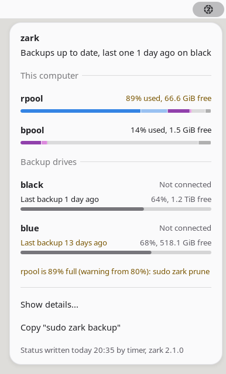
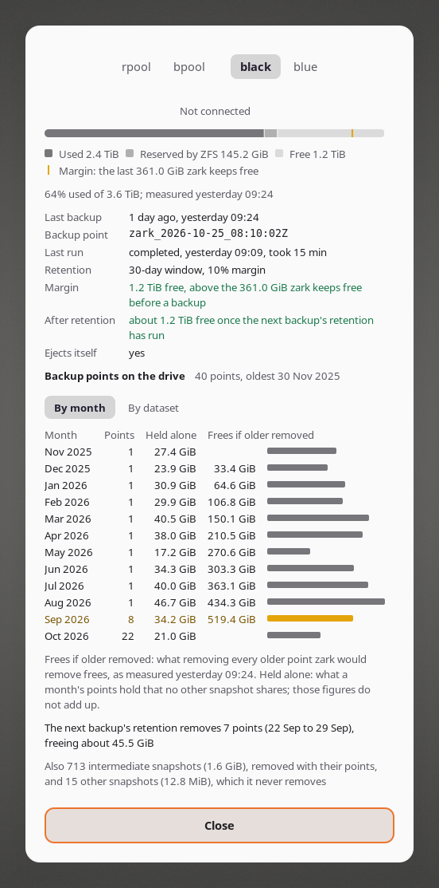

<p align="center">
  <picture>
    <source media="(prefers-color-scheme: dark)" srcset="docs/header-dark.svg">
    
  </picture>
</p>

# zark backup status

[](https://github.com/juanmitaboada/zark-gnome-extension/actions/workflows/ci.yml) [](https://github.com/juanmitaboada/zark-gnome-extension/releases/latest) [](https://launchpad.net/~juanmitaboada/+archive/ubuntu/zark) [](metadata.json) [](COPYING)

A GNOME Shell extension that shows the state of
[zark](https://github.com/juanmitaboada/zark) backups in the top bar: the
last backup to each drive, a running backup's progress, when zark waits for
an answer in its terminal, and how full the system pools are.

zark backs up an Ubuntu system installed on encrypted ZFS to an external
drive, and rebuilds it, bootable, from a live USB when the disk dies. It
runs in a terminal; this extension lets you see from the desktop how your
backups stand.

It is read-only. It reads the two status files zark 2.1.0 and later write
(`/run/zark/progress.json` and `/var/lib/zark/status.json`, described in
zark's [`docs/STATUS-FILES.md`](https://github.com/juanmitaboada/zark/blob/main/docs/STATUS-FILES.md)),
and never starts, stops or changes anything. Backups stay `sudo zark backup`
in a terminal.

## Requirements

- Ubuntu 26.04 LTS, with GNOME Shell 50.
- zark 2.1.0 or later. zark supports Ubuntu 24.04 and 26.04 LTS as their
  installers lay out encrypted ZFS; 24.04 ships GNOME Shell 46, so there
  zark runs without this extension, and `zark monitor` shows the backups'
  state in a terminal.

## Screenshots

The menu, idle and while a backup runs, and waiting for an answer in the
terminal:





The details dialog, a pool's tab and a backup drive's tab:




A backup drive plugged in:



In the light style:




The images come from `dev/screenshots.py`, which plays the contract's
fixtures in a headless GNOME Shell of its own; the drives, pools and
datasets in them are the fixtures' examples.

## What it shows

The panel icon is zark's ring and z:

| Icon | State |
|---|---|
| white | backups up to date |
| orange z, the ring filling clockwise | a backup is running; the next sector beats while data moves |
| blue, the z blinking | zark is waiting for an answer in its terminal |
| red | the last backup to a drive needs attention |
| yellow | a backup is overdue, the status is old or unreadable, or a run stopped answering |
| grey | no status from zark yet |

The menu has the running backup's step, dataset and figures, the system
pools with what fills them, each backup drive with its last backup, zark's
warnings, "Show details..." and a button that copies `sudo zark backup`.

"Show details..." (or a click on a pool or a drive) opens a dialog with a
tab per pool and per drive:

- a pool: a donut of user data, snapshots, system and the rest, its
  datasets as a table sorted by size or by snapshots, and zark's cleanup
  notices with a button that copies `sudo zark prune`;
- a drive: its space with the margin zark keeps free, its last backup and
  run, its retention policy, and, when zark measured them, its backup
  points by month, what the next backup's retention removes, and what
  removing the points older than each month would free.

## Notifications

It notifies what zark itself does not; zark already notifies a backup's
start and result and a full pool.

- A backup overdue, once a day.
- A registered backup drive plugged in, with its last backup.
- A question zark has waited 15 s for; clicking it brings zark's terminal
  forward, and it goes away once answered.
- A zark run that stopped answering.

Each can be turned off in the preferences.

## Install

From the zark PPA, for every user, with zark itself:

```
sudo add-apt-repository ppa:juanmitaboada/zark
sudo apt update
sudo apt install gnome-shell-extension-zark
```

The package `gnome-shell-extension-zark` installs into
`/usr/share/gnome-shell/extensions/zark@juanmitaboada.com/` and brings zark
2.1.0 or later from the same PPA. Turn it on in the Extensions app.

From [extensions.gnome.org](https://extensions.gnome.org/extension/11491/zark-backup-status/),
into your user's extensions directory, once it is approved there (it is
awaiting review; until then, use the PPA). It does not install zark:
install zark from the PPA, or run it from its portable tarball (see zark's
README).

If both are installed, GNOME Shell loads the copy in your user's directory,
the one from extensions.gnome.org, and ignores the system one.

## Preferences

In the Extensions app:

- General: the four notifications, and what the extension is.
- Development: the status file, the progress file and the drive links
  directory. Change them only to test with example files; zark writes the
  defaults. "Restore defaults" puts them back.

## Privacy

It reads zark's two status files, `/proc` (to tell a live zark run from one
that stopped) and `/dev/disk/by-id` (to tell which drives are plugged in).
It uses no network and runs no program. It writes to the clipboard only
when a Copy button is pressed, and reads nothing from it.

## If it says "Status not refreshed"

zark writes `status.json` at the end of every run and from an hourly timer.
An old status means the timer is not installed, or the zark it runs is gone
(a stick that was unplugged). `sudo zark alerts install` installs it again.

## Development

| Command | What it does |
|---|---|
| `make test` | runs the tests under gjs |
| `npm ci && make lint` | ESLint with GNOME's rules |
| `make pack` | builds `zark@juanmitaboada.com.shell-extension.zip` for extensions.gnome.org from the last commit, every entry dated at it (needs `gnome-extensions`) |
| `make fixtures ZARK_FIXTURES=<zark>/tests/fixtures/status` | copies the status files contract's fixtures into `tests/fixtures/` |
| `make icons ZARK_BRAND=<zark>/docs/images/brand/zark-symbolic.svg` | rebuilds the panel icons from zark's panel mark |
| `dev/simulate.py <dir> [--speed N] [--result incomplete] [--answer-after S] [--fixture CASE]` | plays a backup into `<dir>/run/zark` and `<dir>/var/lib/zark`, as zark writes them, from the `idle` fixture or another case (`drive-contents` for a drive's contents); point the extension's paths there in its preferences |
| `dev/simulate.py <dir> --plug NAME`, `--unplug NAME`, `--overdue` | plugs a registered drive in or out under `<dir>/dev/disk/by-id`, or makes the backup overdue, to try the notifications |

## Debian package

`debian/` builds `gnome-shell-extension-zark` (Architecture `all`, `Depends:
gnome-shell (>= 50), zark (>= 2.1.0)`) for `ppa:juanmitaboada/zark`. The
schema goes to `/usr/share/glib-2.0/schemas/`, compiled by glib's trigger.

| Command | What it does |
|---|---|
| `make deb` | the unsigned `.deb` in the parent directory, built from the source package, with lintian on the binary and the source (needs `devscripts`, `debhelper`, `lintian`) |
| `make deb-ppa` | from a signed tag `v<version-name>` only: a signed source package per series (`<version>-1~ubuntu26.04.1` for resolute), uploaded with `dput` |

A release: the version in `metadata.json` (`version-name`) and the top
entry of `debian/changelog` agree, the commit is tagged with `git tag -s
v<version>` and pushed, and `make deb-ppa` runs on that tag; `make
release-guard` refuses a dirty tree, an unsigned tag or a changelog of
another version.

`lib/contract.js`, `lib/state.js`, `lib/format.js`, `lib/usage.js`,
`lib/view.js` and `lib/events.js` import nothing from GNOME Shell, so the
tests run them without a shell. The fixture tests check every case of the
contract against its `expected.json`.

## License

GPL-2.0-or-later. Copyright Juanmi Taboada
([juanmitaboada.com](https://www.juanmitaboada.com)).
